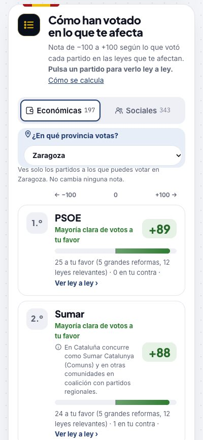

<h1 align="center">¿A quién te conviene votar?</h1>

<p align="center"><b>Lo que votó cada partido en las leyes que tocan tu sueldo, tu casa, tu negocio y tu familia.</b><br>
Leyes y votos reales, de fuentes oficiales · Cálculo trazable ley a ley · Sin recoger ningún dato tuyo</p>

<p align="center">
  <a href="https://www.votarbien.info/"><b>Abrir la web →</b></a>
  &nbsp;·&nbsp; <a href="#datos-reales-y-trazables">Trazabilidad</a>
  &nbsp;·&nbsp; <a href="#privacidad">Privacidad</a>
  &nbsp;·&nbsp; <a href="#cómo-se-calcula">Cómo se calcula</a>
  &nbsp;·&nbsp; <a href="#reconstruir-los-datos">Reconstruir los datos</a>
  &nbsp;·&nbsp; <a href="#fuentes-y-licencia">Fuentes</a>
</p>

<p align="center">
  
  
  
  
</p>

<table>
  <tr>
    <td width="72%"></td>
    <td width="28%"></td>
  </tr>
</table>

---

## Qué es

Tú madrugas, trabajas y pagas tus impuestos. **Ellos votan leyes.** Esta web te enseña qué votó cada partido cuando se decidía tu sueldo, tu casa, tu negocio y tu familia: no lo que prometió en campaña, sino lo que votó.

| | | |
|:---:|:---:|:---:|
| **1 · Marca tu situación** | **2 · Mira quién votó a tu favor** | **3 · Compruébalo tú mismo** |
| Sueldo, impuestos, vivienda, familia, negocio. Un minuto, sin registro: lo que marcas no sale de tu navegador. | Una nota de −100 a +100 por partido, según cómo votó las leyes que te afectan. | Cada ley, su voto y por qué te afecta, con enlace al registro oficial. |

<p align="center"></p>

> **Tu voto es tuyo.** Aquí nadie te dice a quién votar: te enseñamos lo que votaron.

## Datos reales y trazables

Cada número de la web se puede seguir hasta la ley y la votación de las que sale. Sin cajas negras.

| Qué ves | De dónde sale | ¿Se puede comprobar? |
|---|---|---|
| **Leyes e iniciativas**: título, tipo, autor, fechas, resultado | Datos abiertos del [Congreso](https://www.congreso.es/es/opendata) y del [Parlamento Europeo](https://data.europarl.europa.eu) | Sí: cada ley enlaza a su ficha oficial |
| **Votos**: qué votó cada partido y en qué votación | Votaciones nominales del Pleno (Congreso, actas del PE y [HowTheyVote.eu](https://howtheyvote.eu)) | Sí: votación, fecha y voto de cada partido, ley a ley |
| **A quién afecta cada ley** y su alcance | Clasificación propia, hecha con ayuda de IA según una [rúbrica pública](data/clasificacion/RUBRICA.md) | Sí: está en [`data/clasificacion/`](data/clasificacion), y la web la muestra junto a cada ley |
| **La nota de cada partido** | Se calcula en tu navegador con una fórmula pública | Sí: la ficha del partido desglosa cuánto suma o resta cada ley |

**La cadena completa:** fuente oficial → `data/fuente/` (descarga tal cual) → `data/clasificacion/` (clasificación pública) → `site/data/<legislatura>.json` (lo que carga la web, descargable) → cálculo en tu navegador → desglose ley a ley en la ficha del partido.

**Ejemplo de cómo se rastrea una nota.** Si un partido votó a favor del proyecto de ley de reducción de la jornada laboral ([121/000058](https://www.congreso.es/es/busqueda-de-iniciativas?p_p_id=iniciativas&p_p_lifecycle=0&p_p_state=normal&p_p_mode=view&_iniciativas_mode=mostrarDetalle&_iniciativas_legislatura=XV&_iniciativas_id=121/000058)) y tu perfil es un asalariado de 20.200–35.200 €:

- **Alcance:** es una gran reforma, así que pesa ×9.
- **Fuerza:** la votación clave fue una enmienda a la totalidad, que vale 0,5.
- **Aportación:** suma +4,5 a favor de ese partido en tu nota.

Esa misma línea aparece en la ficha del partido, junto a todas las demás, y la suma de todas da su nota.

> **Lo que es oficial y lo que no.** Las leyes, las fechas y los votos son datos oficiales, sin tocar. Decidir a quién beneficia o perjudica una ley es una interpretación: por eso es pública, sigue una rúbrica fija igual para todos los partidos y se enseña al lado de cada ley para que la juzgues tú. Si ves una mal clasificada, abre un *issue*.

## Privacidad

**No sale de tu dispositivo: tus respuestas se guardan solo en este navegador.**

- Lo que marcas se calcula en tu navegador. No se envía a ningún servidor, no hay registro, ni cookies, ni analítica.
- La web es HTML estático en GitHub Pages; solo descarga los datos públicos de cada legislatura y las tipografías de Google Fonts.
- En tu propio navegador (`localStorage`) se recuerdan tus respuestas del perfil, para no perderlas al recargar, la provincia del filtro y dos preferencias de pantalla (ocultar partidos con pocos datos y pausar la animación). Nada de eso sale de tu dispositivo.
- El botón **«Borrar mis respuestas»** (en la barra de tu perfil y en el pie) borra del navegador el perfil y la provincia y reinicia el asistente.
- Compartir tu perfil es opcional: el enlace lleva en la URL (`?p=…`) los rasgos de los pasos 1 a 3 y solo lo tiene quien tú se lo pases. **Lo que marques en el paso 4 (sexo, estado civil, cuidados, orientación, salud, discapacidad, origen y demás situación personal) nunca va en el enlace**: se queda en tu navegador.

## Qué datos incluye

| Fuente | Legislatura | Iniciativas | Con votación clave |
|---|---|---:|---:|
| Congreso de los Diputados | XV · 2023–2026 | 540 | 213 |
| Congreso de los Diputados | XIV · 2019–2023 | 662 | 284 |
| Congreso de los Diputados | XIII · 2019 | 88 | 2 |
| Congreso de los Diputados | XII · 2016–2019 | 508 | 158 |
| Congreso de los Diputados | XI · 2016 | 51 | 7 |
| Congreso de los Diputados | X · 2011–2015 | 510 | 295 |
| Parlamento Europeo | 10.ª · 2024–2029 (en curso) | 260 | 260 |
| Parlamento Europeo | 9.ª · 2019–2024 | 545 | 545 |
| Parlamento Europeo | 8.ª · 2014–2019 | 949 | 949 |
| Parlamento Europeo | 7.ª · 2009–2014 | 931 | 931 |
| Parlamento Europeo | 6.ª · 2004–2009 | 582 | 582 |

Cada fuente y legislatura es un dataset independiente. Los partidos cambian entre legislaturas, así que **nunca se mezclan**: la web tiene un selector de fuente y otro de legislatura.

## Cómo se calcula

- **Autoría.** Los proyectos de ley y los reales decretos-ley son del Gobierno. Una proposición firmada por varios grupos cuenta para cada uno. Las del Grupo Mixto aparecen como «Grupo Mixto» porque el Congreso no indica el partido, salvo las que se han podido identificar (campo `partido` en `clas_*.json`).
- **Votación clave por iniciativa**, por este orden de prioridad: votación final (de conjunto o del dictamen) > convalidación del real decreto-ley > toma en consideración > enmienda a la totalidad. En la enmienda a la totalidad, votar sí equivale a oponerse a la ley, y se invierte.
- **Voto de un partido** = voto mayoritario de sus diputados presentes. Los partidos que comparten grupo, como Podemos, BNG, CC, UPN o Compromís dentro del Mixto, se separan por voto nominal. Los no adscritos no se cuentan.
- **Impactos.** Cada iniciativa se clasifica como económica o social y se marca a qué colectivos beneficia (+1) o perjudica (−1), según [`RUBRICA.md`](data/clasificacion/RUBRICA.md). La clasificación es asistida por IA e **interpretativa**: conviene revisar las leyes de mayor relevancia.
- **Nota del ranking.** (a favor − en contra) ÷ total × 100. Votar el texto final pesa 1, una toma en consideración 0,5 y lo que solo se presentó 0,25. Una gran reforma pesa como 9 leyes menores, y una ley relevante como 3.
- **Colores.** Verde: beneficia algún rasgo de tu perfil y no perjudica ninguno. Rojo: al revés. Ámbar: ambas cosas. Gris: no te afecta.

La metodología completa está en la propia web, en el apartado **Cómo se calcula**.

## Reconstruir los datos

```bash
python3 scripts/build_items.py congreso_xv       # fuente → items normalizados
python3 scripts/validar_clasificacion.py         # tiene que dar 0 errores
python3 scripts/build_data.py congreso_xv        # items + clasificación + votos → site/data
python3 scripts/build_page.py                    # template.html → index.html
```

`build_data.py` imprime las votaciones que reasigna, porque la web del Congreso no siempre indica el expediente de cada votación y se comprueba comparando títulos. La página carga los datos con `fetch`, así que en local tienes que servirla:

```bash
python3 -m http.server 8000 --directory site    # http://localhost:8000
```

<details>
<summary><b>Añadir una legislatura</b></summary>

1. **Descargar:** `python3 scripts/descargar_legislatura.py --leg XIV --desde 2019-12-03 --hasta 2023-05-30`. Tarda entre 1,5 y 2 h (una petición cada ~2,5 s) y se puede reanudar.
2. **Configurar** grupos, partidos y textos en `scripts/legislaturas.py`.
3. **Clasificar:** `build_items.py <clave>` y después el proceso de [`INSTRUCCIONES.md`](data/clasificacion/INSTRUCCIONES.md): `preparar_lotes.py` → clasificar los lotes → `integrar_clasificacion.py`.
4. **Grupo Mixto o Plural:** `.venv/bin/python scripts/identificar_mixto.py <clave>` y llevar el partido a `clas_*.json`.
5. **Publicar:** `build_data.py <clave>` y `build_page.py`. La legislatura aparece sola en el selector.

**Parlamento Europeo:** `python3 scripts/descargar_europarlamento.py [--actualizar]` para la 9.ª y la 10.ª, y `scripts/descargar_europarlamento_historico.py` para la 6.ª, 7.ª y 8.ª. Usan un formato propio, declarado con `"formato": "europarlamento"` en `legislaturas.py`; el resto del proceso es igual.

> **Aviso:** congreso.es tiene protección anti-bots. Nunca lances peticiones en paralelo, deja una cada 2-3 s y para ante un 403.

</details>

<details>
<summary><b>Estructura del repositorio</b></summary>

```
data/
  fuente/                       Datos de origen, uno por dataset (no se editan)
  clasificacion/
    RUBRICA.md                  Criterios de clasificación, comunes a todas las legislaturas
    INSTRUCCIONES.md            Proceso para clasificar lotes
    <clave>/clas_*.json         Tipo, impactos por colectivo (+1/−1) y nota de cada iniciativa
    <clave>/REVISION.md         Casos dudosos pendientes de revisión
  generado/<clave>/items.json   Iniciativas normalizadas (generado; no editar)
  cache/                        Respuestas de congreso.es (ignorado por git)
scripts/
  legislaturas.py               Configuración por legislatura: grupos, partidos, textos
  descargar_legislatura.py      Iniciativas y votaciones del Pleno del Congreso (reanudable)
  descargar_historico.sh        Descarga en serie de las legislaturas X–XIII
  descargar_europarlamento.py   Parlamento Europeo 9.ª y 10.ª: procedimientos y voto de eurodiputados españoles
  descargar_europarlamento_historico.py  Parlamento Europeo 6.ª a 8.ª (actas oficiales del PE y Parltrack)
  identificar_mixto.py          Partido de las proposiciones del Mixto y del Plural (por el BOCG)
  textos_bocg.py                Texto de iniciativas concretas para revisar su clasificación
  build_items.py                fuente → items.json
  build_data.py                 items + clasificación + votaciones → site/data/<clave>.json
  build_page.py                 template.html + catálogo de datasets → index.html
  preparar_lotes.py             Lotes de iniciativas sin clasificar
  integrar_clasificacion.py     Integra lotes, armoniza RDL duplicados y valida
  validar_clasificacion.py      Comprueba clas_*.json contra la rúbrica y la web
site/
  template.html                 La página: HTML/CSS/JS sin dependencias (solo Google Fonts)
  index.html                    Página final (generada)
  data/<clave>.json             Un dataset por fuente y legislatura
```

</details>

## Publicación

Cada push a `main` que toque `site/` publica la carpeta en GitHub Pages (`.github/workflows/pages.yml`).

Los enlaces se pueden compartir con un perfil ya marcado:

| Parámetro | Qué hace | Ejemplo |
|---|---|---|
| `p` | Rasgos del perfil, separados por comas (la web nunca pone en el enlace los del paso 4, de situación personal) | `?p=asal3,prop1` |
| `rdl=0` | Excluye los reales decretos-ley del cálculo (por defecto se cuentan) | `?p=asal3&rdl=0` |
| `c=0` | Desactiva «Ciudadanía general», que viene activa | `?p=asal3&c=0` |
| `ds` | Abre otra legislatura (por defecto, la más reciente) | `?ds=congreso_xiv` |

## Pendiente

- [ ] **Imagen de previsualización** (Open Graph) y metaetiquetas para compartir en redes y WhatsApp.
- [ ] **Revisar las clasificaciones** de las leyes más relevantes: fiscales, vivienda, pensiones, laboral, migración.
- [ ] **Identificar el partido** de las proposiciones del Grupo Mixto (ficha de cada iniciativa en congreso.es, campo de autores o firmantes).
- [ ] **Convertir la clasificación en un proceso repetible** entre legislaturas.
- [ ] **Leyes ómnibus:** leer el texto (BOE / BOCG) y clasificar medida a medida.

## Fuentes y licencia

- **Congreso de los Diputados**, datos abiertos: <https://www.congreso.es/es/opendata>. Su reutilización exige citar la fuente.
- **Parlamento Europeo:** votaciones nominales de [HowTheyVote.eu](https://howtheyvote.eu) (9.ª y 10.ª, datos abiertos con atribución) y de las actas oficiales del Parlamento Europeo (6.ª a 8.ª); títulos y fechas de la [API de datos abiertos del Parlamento Europeo](https://data.europarl.europa.eu). Para la 6.ª, también [Parltrack](https://parltrack.org) (ODbL 1.0).

La clasificación de impactos es propia e interpretativa. Si ves una ley mal clasificada, abre un *issue*.
